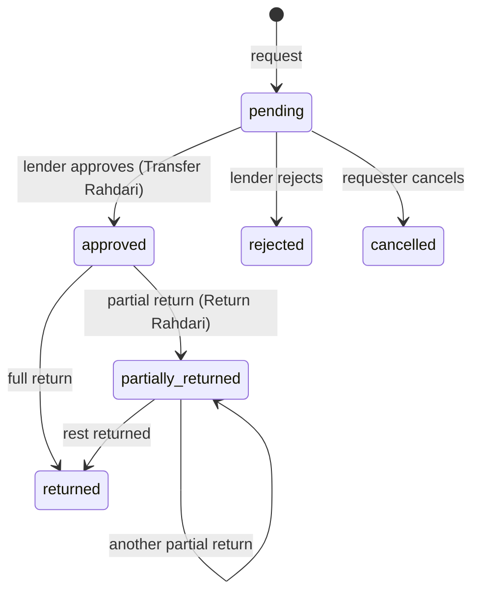

# Stock: Features

Stock is a mobile-first inventory app for RSSB centers that installs as a PWA. Each department tracks its own
stock and can borrow from other departments. Every stock movement issues a numbered **Rahdari** (राहदारी): a
PDF you can share, which the receiver confirms by scanning its QR code. Data is organised as **centers →
departments → items**. In code, a Rahdari is called a `challan`.

See [PLAN.md](PLAN.md) for design decisions and open questions, and [README.md](README.md) for setup.

---

## 1. Roles and access

Access is set per department. A user is a **manager** or a **viewer** in each department they belong to. A
global **admin** acts as a manager in every department. Every signed-in user can see stock levels, so
departments know whom to borrow from. Only members of the departments involved can see Rahdari, borrows and
bill photos.

| Action | Admin | Dept manager | Dept viewer | Anyone with the QR link |
|---|---|---|---|---|
| View stock levels in all departments | Yes | Yes | Yes | No |
| View Rahdari, borrows, bill photos | All | Own depts | Own depts | That one Rahdari |
| Receive, issue, adjust stock; set required qty | Yes | Own dept | No | No |
| Request items from another dept | Yes | For own dept | No | No |
| Approve or reject a request | Yes | Lending dept | No | No |
| Cancel a pending request | Yes | Requesting dept | No | No |
| Record a return | Yes | Either dept | No | No |
| Acknowledge a transfer or return | Yes | Receiving dept | Receiving dept | Yes, once |
| Edit the item catalog | Yes | Yes (any dept manager) | No | No |
| Void a Rahdari | Yes, with a reason | No | No | No |
| Manage centers, departments, users | Yes | No | No | No |

- **Sign-in:** username and password (better-auth). Public sign-up is turned off, so only admins create accounts.
- **Route protection:** every page except sign-in, the offline page, app icons and `/r/...` redirects to sign-in.
- **Safe deletes:** a user who has issued Rahdari or requests can't be deleted (change their role instead), and
  admins can't delete themselves.

## 2. App shell and navigation

- **Bottom tab bar:** Home · Stock · ➕ · Rahdari · More.
- **➕ quick-action sheet:** Receive stock, Request items, Record return, Issue items, Adjust, Scan. Viewers
  see "Only department managers can add entries."
- **Department switcher** in the top bar. The selected department drives Home, Stock and new entries.
  Users with no department get a prompt to ask an admin.
- **Offline indicator** in the shell; "View only" badge for viewers.
- **Bottom sheets** for all forms, 44 px tap targets, safe-area insets, one-handed use.
- **Theme:** Auto (follows the system), Light, Dark.

## 3. Screens and features

### Home

- Search-or-scan bar.
- **Requests to approve**, with inline Approve / Reject.
- **To return:** borrowed items you still owe, with due dates.
- **Waiting for approval:** requests you've sent.
- **Low stock:** items below their required quantity, with a progress bar. Shows "Everything is at or above
  required levels" when nothing is low.
- **Recent Rahdari.**

### Stock

- Searchable list of the current department's stock (on hand vs required). Has a scan shortcut.
- **Item page:**
  - On-hand quantity, and the required quantity, which managers can edit.
  - **Where it's held:** quantities in other departments, to see whom to borrow from.
  - **Movements here:** the item's history in this department (received, issued, adjusted, lent, borrowed,
    returned).
  - Shortcuts: Request, Issue, Adjust.

### Entry forms (bottom sheets)

| Form | What it does | Rahdari issued |
|---|---|---|
| Receive stock | Intake from a vendor or donor: vendor name, their bill no., rate per line, optional bill photo | Receipt (`RC`), an invoice with amounts and total |
| Request items | Ask another department for items, with an optional return-by date | None until approved |
| Record return | Pick an open borrow, enter returned qty per line or "Return all" | Return (`RT`), one per return event |
| Issue items | Stock leaving for good (used up or given out), with the person or event it went to | Issue (`IS`) |
| Adjust | Add or remove to fix a count. A reason is required. | Adjustment (`AD`) |
| Scan | Find an item by barcode or by its QR label | None |

Shared entry helpers:

- **Item picker:** full-screen search by name, SKU or barcode. Recent items come first. On Receive stock, you
  can create a new item inline from the search text.
- **Cart-style line editor:** add several items, set quantities with a big stepper and a numeric keypad, and
  remove a line with one tap.
- **Availability check:** when requesting, it shows how much the lending department has.

### Borrows

- Two tabs: **Asked of us** and **We asked**. Shows due dates and flags overdue loans.
- **Borrow detail:** lines with returned-of-requested counts, the requester, and linked Rahdari. Actions:
  **Approve & issue Rahdari**, **Reject**, **Cancel request**, **Record return**.
- Approving moves the stock and issues a **Transfer** Rahdari (`TR`).

### Rahdari

- **List** for the current department, filtered by kind (Receipt, Transfer, Return, Adjustment, Issue),
  paginated with "Load more". Shows offline entries waiting to sync, with a **Sync now** button and an option
  to delete a queued entry.
- **Detail:** number, kind, from → to, lines, vendor/bill no. or recipient, who issued it, receipt status, and
  the vendor bill photo.
  - **Share PDF** (Web Share API), **WhatsApp**, **Download PDF**.
  - QR code: "Receiver scans this to confirm."
  - **Mark received:** in-app acknowledgement by a member of the receiving department (transfers and returns).
  - **Void** (admins only; receipts, adjustments and issues): requires a reason and reverses the stock. The
    number stays in the register, marked void.
- **Statuses:** Issued → Received (acknowledged), or Void.
- **Numbering:** `CENTER/FY/KIND-#####` (for example `SKP/2026-27/TR-00042`). The fiscal year runs April to
  March in IST. Numbers are gapless per center, year and kind, and are taken in the same database transaction
  as the stock movement.

### Rahdari PDF

- A5 portrait: center header, number, date, from → to, numbered lines (with rate and amount on receipts),
  issued-by and received-by signature blocks, and a "Scan to verify" QR code.
- Title changes by kind (for example "Goods Receipt / Invoice", "Rahdari — Transfer"). Void Rahdari get a
  VOID stamp.
- Noto Sans fonts, including Devanagari, so Hindi prints correctly.

### Public verify page (`/r/[token]`, no login)

- Opened by scanning the QR code. Shows the number, status and lines, and lets you download the PDF.
- One-time **"I received these items"** form: name, plus an optional phone number. It's rate-limited, and the
  token can't be guessed.
- Handles cancelled (void) and not-found Rahdari, as well as kinds that don't need acknowledgement.

### Reports (More → Reports)

- **Rahdari register CSV:** date range plus department filter, one row per line. The CSV is safe to open in
  Excel or Google Sheets (formula injection is neutralised). Non-admins only get their own departments.
- **Outstanding borrows:** approved loans with items still out, oldest due first, overdue highlighted.
- **Stock by department:** collapsible per department, with short items flagged.

### More

- Work: Borrows, Reports.
- Manage (admin): Centers, Departments, Items, Users.
- Language (English / हिन्दी), Theme, Notifications on/off, Install app (with iPhone instructions), Sign out.
- Sign-out warns if offline entries haven't synced yet, because they'd be lost.

### Admin screens

- **Centers:** add, edit and delete (code, name, address).
- **Departments:** add, edit and delete, each under a center.
- **Items (catalog):** name, SKU, unit, barcode, description. Search and scan. SKU and barcode must be unique.
  Any department manager can edit the catalog.
- **Print QR labels:** printable item labels that encode `STOCK:ITEM:<SKU>`.
- **Users:** create (name, username, password), set the global role (Admin / Catalog manager / Member),
  assign departments with Manager or Viewer access, and delete.

## 4. Scanning

- Uses the camera through the browser `BarcodeDetector` API, falling back to ZXing where that API isn't
  supported.
- Matches real product barcodes as-is, and matches the app's own QR labels by SKU.
- If there's no camera, you can type the barcode or SKU instead.

## 5. Offline and PWA

- **Installable:** manifest, generated icons, standalone display on Android and iOS.
- **Service worker:** caches the app shell, pages you've visited and an offline fallback page. It only
  registers in production builds.
- **Offline reads:** the TanStack Query cache persists to IndexedDB, so stock, items and Rahdari stay
  readable without signal.
- **Offline writes:** Receive, Issue, Adjust and Return are queued per user in IndexedDB. They replay on
  reconnect, and the server deduplicates them by `client_mutation_id`, so a replay can't create two entries.
  Rahdari numbers are assigned on sync, which keeps numbering gapless.
- Approving a borrow only works online.
- If a receipt is saved offline, the bill photo is skipped, and the app tells the user to attach the paper bill.

## 6. Notifications (Web Push)

- Opt-in from More. Each device gets notifications in its own language.

| Event | Who is notified |
|---|---|
| New borrow request | Managers of the lending department |
| Request approved or rejected | The person who made the request |
| Items returned | Managers of the lending department |
| Rahdari received (acknowledged) | The person who issued it (unless they acknowledged it themselves) |

- Push needs VAPID keys on the server, and on iPhone the app has to be installed to the Home Screen first.

## 7. Language

- Full English and Hindi across the UI, PDFs and push notifications. TypeScript requires every string key to
  exist in both dictionaries (`lib/i18n/`).

## 8. Bill photos

- You can photograph the vendor bill on a Receipt. The phone compresses it (max 1600 px, JPEG) and it's stored
  in Postgres, so no object storage is needed. Only members of the departments involved can view it.

## 9. Data model (summary)

| Table | Holds |
|---|---|
| `centers`, `departments`, `items` | Organisation and item catalog (`items.barcode` unique, nullable) |
| `department_inventory` | On-hand and required quantity per department × item |
| `inventory_transactions` | Every stock movement: intake, issue, adjustment, borrow out/in, return out/in. Each row points at its Rahdari. |
| `borrows`, `borrow_items` | Requests between departments, with requested and returned quantities and an optional due date |
| `challans`, `challan_lines` | Rahdari header (kind, status, parties, totals, acknowledgement, public token) and lines |
| `challan_series` | Next number per center × fiscal year × kind |
| `user_departments` | Department membership with manager or viewer role |
| `push_subscriptions` | Web Push endpoints per user, with locale |
| `attachments` | Vendor bill photos |
| `user`, `session`, `account`, `verification` | better-auth |

## 10. Status

- All four planned phases (bootstrap, daily jobs, field polish, offline and notifications) were built on
  2026-10-21.
- Tested: integration tests cover gapless numbering under concurrency, approve and partial-return producing the
  right Rahdari, and department scoping. Main flows were also exercised at a 390×844 mobile viewport.
- Not yet done: manual install and push testing on a real Android phone and iPhone.
- Open questions: production hosting (`APP_URL`, VAPID keys) and whether receipts need GST fields (not built).
